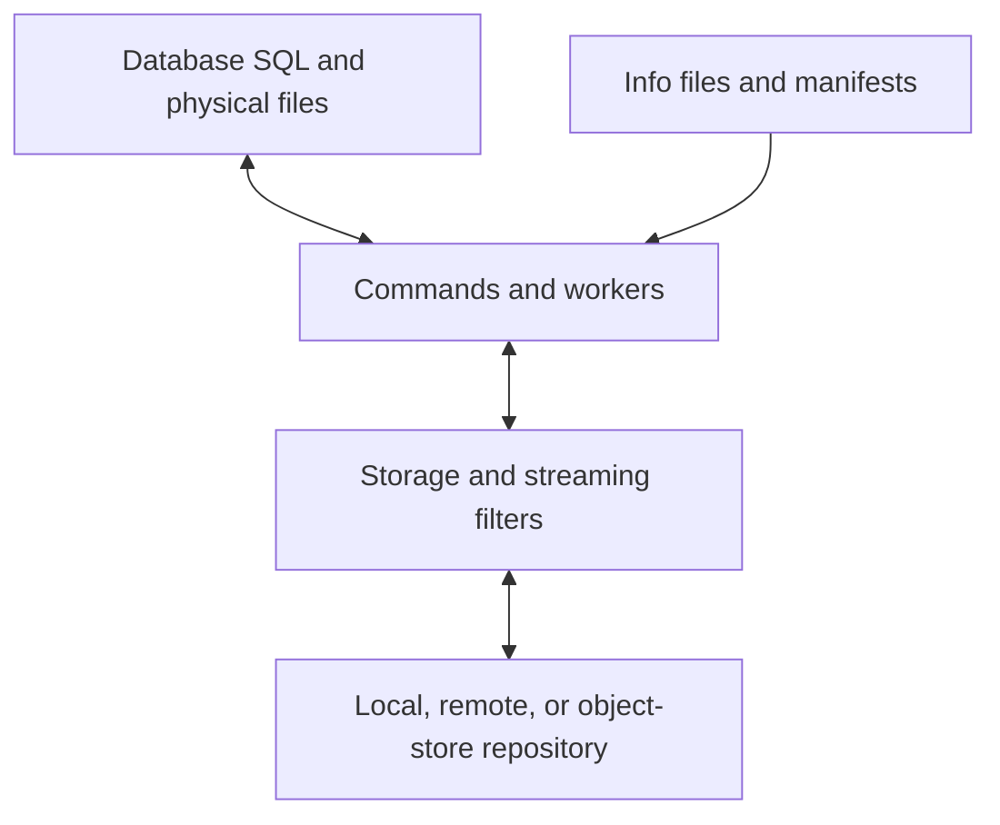

# System overview

[Wiki home](README.md)

pgBackRest creates physical database backups and supplies the WAL needed to recover them. A physical backup captures database files. PostgreSQL or its supported fork replays WAL to make restored files consistent and, if requested, recover to a later target.

## Core concepts

| Concept | Meaning |
|---|---|
| Stanza | Named configuration and repository namespace for a database cluster |
| Repository | Storage for backups, archived WAL, and metadata |
| Full backup | A new complete backup basis |
| Differential backup | Changes relative to a full backup |
| Incremental backup | Changes relative to a prior backup |
| Manifest | Detailed description of a backup and its file/block references |
| WAL archive | History needed for recovery and point-in-time recovery |
| Spool | Local queue/status area used by asynchronous archiving |

The usual lifecycle is `stanza-create → check → backup → info/verify → restore`, with `archive-push` running continuously and `archive-get` supplying recovery WAL. `expire` applies retention while respecting backup dependencies and required WAL ranges.

## Component relationships

Runtime logic is primarily C. Perl orchestrates much of testing, CI, and documentation. Build tools generate configuration, help, error, and PostgreSQL interface data from declarative inputs.

Copying files alone does not establish that a backup is recoverable: database identity, metadata, and WAL availability matter. A restored directory still needs database recovery. The fork also supports GPDB-style deployments, where coordinator and segment operations need a coordinated procedure.

Continue with the [source map](source-map.md), [backup](workflows/backup.md), [restore](workflows/restore.md), or [Greenplum](fork/greenplum.md).

## Source entry points

- [README.md](https://github.com/riogor/pgbackrest/blob/b8ce272231bac178ba39fffc8561b058ab150a0b/README.md)
- [src/main.c](https://github.com/riogor/pgbackrest/blob/b8ce272231bac178ba39fffc8561b058ab150a0b/src/main.c)
- [README_GPDB_en.md](https://github.com/riogor/pgbackrest/blob/b8ce272231bac178ba39fffc8561b058ab150a0b/README_GPDB_en.md)
